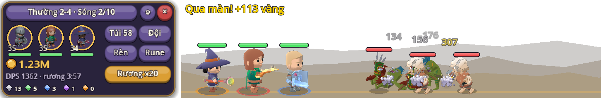
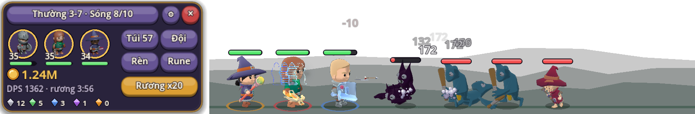
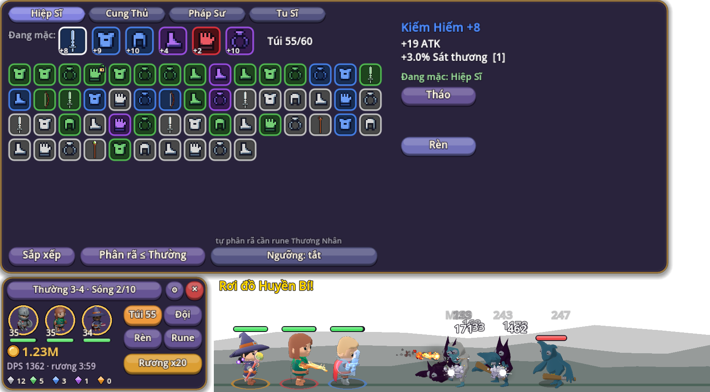
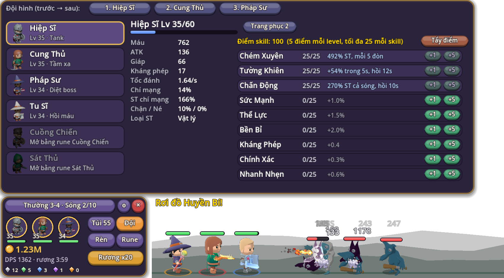
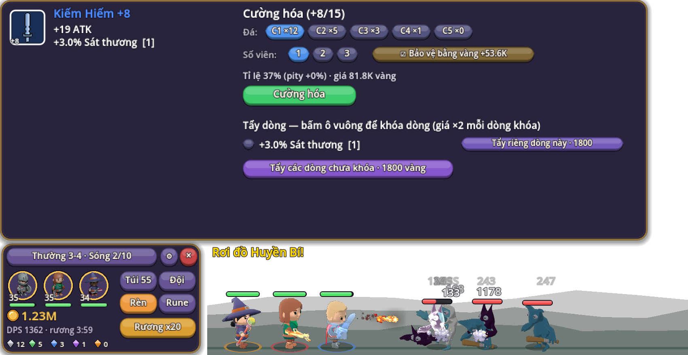

# Taskbar Idle

Game idle RPG chạy trong một dải trong suốt ngay trên thanh taskbar (trên macOS là ngay trên Dock). Đội hero tự đánh quái, rơi đồ, mở rương theo giờ thực, trong lúc bạn làm việc khác. Lấy cảm hứng từ thể loại "bottom-of-your-screen" và *TBH: Task Bar Hero*, nhưng toàn bộ tên, hình và âm thanh đều là của dự án này.

Làm bằng **Godot 4.7** (GDScript). Thiết kế theo các quyết định trong [docs/core-rpg-quyet-dinh.docx](docs/core-rpg-quyet-dinh.docx). Nhân vật và quái là model 3D chibi fantasy từ [KayKit](https://github.com/KayKit-Game-Assets) và [Quaternius](https://quaternius.com/packs/ultimatemonsters.html) (CC0), làm gọn bằng Blender và tô bằng shader cel lì; icon vũ khí từ [0x72 DungeonTileset II](https://0x72.itch.io/dungeontileset-ii) (CC0), hiệu ứng skill từ [pixelfx](https://github.com/patch-gg/pixelfx) (MIT), âm thanh và nhạc tạo bằng code.




| Túi đồ | Đội và cây skill | Lò rèn |
| --- | --- | --- |
|  |  |  |

## Tính năng

- **Cửa sổ taskbar:** dải trong suốt, không viền, luôn nằm trên cùng. Chỉ HUD và panel bắt chuột; vùng còn lại bấm xuyên tới ứng dụng phía sau. Nền đồi núi sinh từ seed của màn, chỉnh được độ đậm.
- **Chiến đấu:** hero có máu, gục rồi hồi sinh sau 8 giây; cả sóng quái (2–5 con) đứng trên sân; cả đội gục thì đánh lại từ sóng 1. Quái cận chiến đánh hero đứng đầu, quái tầm xa bắn ngẫu nhiên, Pháp Sư Xương bắn xuyên cả đội. Sát thương vật lý bị giáp chặn (công thức TBH), phép bị kháng phép chặn.
- **6 class:** Hiệp Sĩ, Cung Thủ, Pháp Sư, Tu Sĩ, Cuồng Chiến, Sát Thủ, mở bằng rune; tự xếp đội 3 ô. Mỗi class 3 skill chủ động (theo số đòn hoặc hồi chiêu) và 6 nội tại, 5 điểm mỗi level, tối đa 25 điểm mỗi skill, tẩy điểm miễn phí.
- **3 act × 10 màn × 4 độ khó** (Thường, Ác Mộng, Địa Ngục, Đày Đọa) theo dải level màn của TBH, độ khó cao trừ kháng phép. Boss màn và boss act có kỹ năng: đập đất có báo trước, gọi lính, nổi giận dưới 30% máu. Quái tinh anh có 1–4 thuộc tính ngẫu nhiên và tên sinh tự động; con càng nhiều thuộc tính thì mỗi thuộc tính càng yếu đi, để tinh anh 4 thuộc tính không mạnh hơn boss.
- **Trang bị 6 ô** (vũ khí và giáp theo class; mũ, giày, găng, trang sức dùng chung), 6 phẩm từ Common tới Immortal, dòng phụ 1–4 dòng với điểm chất lượng 1–10 tô màu kiểu MU. Túi từng món riêng, khóa món, sắp xếp, phân rã ra vàng và đá cường hóa, tự phân rã theo ngưỡng (rune). Bảo hiểm: 1000 rương chưa ra Immortal thì chắc chắn ra một món.
- **Lò rèn:** cường hóa từng món tới +15 bằng vàng và 1–3 đá (cấp 1–5); từ +7 thất bại lùi 1 cấp nhưng không qua mốc +6/+9/+12; pity +3% mỗi lần trượt; tùy chọn bảo vệ bằng vàng. Tẩy dòng phụ, khóa dòng (giá ×2 mỗi dòng khóa) hoặc tẩy riêng một dòng.
- **Hình theo trang bị:** vũ khí tô màu theo phẩm, vòng sáng dưới chân theo phẩm giáp, vũ khí phát sáng từ +7; 2 trang phục mỗi class.
- **Cây rune 25 node:** mở class và ô đội, chỉ số, túi, rương, tự mở rương, tự phân rã, rèn rẻ hơn, offline, và 3 rune không giới hạn cấp (ATK, Máu + giáp, EXP) với giá tăng theo đa thức để vàng cuối game vẫn đổi được ra sức mạnh.
- **Endgame:** Vùng Hỗn Mang cường độ 1–20 và Tháp vô tận. Lần đầu hạ boss nhận thưởng gấp 5.
- **Rương theo giờ thực** chỉ rơi khi game mở; thưởng offline có ngay từ đầu, trần 8 giờ (12 giờ với rune).
- **Âm thanh và nhạc** tạo bằng code; nút Bật/Nhỏ/Tắt.
- **Save:** JSON trong `user://save.json`, tự lưu mỗi 30 giây. Save của bản prototype cũ không dùng được nữa; game bắt đầu lại từ đầu.

## Chạy game

Cần [Godot 4.7](https://godotengine.org/download) (bản thường, không cần .NET).

```bash
godot --path game
```

Trên macOS, nếu Godot nằm trong `/Applications`:

```bash
/Applications/Godot.app/Contents/MacOS/Godot --path game
```

Hoặc mở `game/project.godot` trong Godot Editor rồi bấm Run. Cửa sổ trong suốt chỉ hiện đúng khi chạy game, không hiện trong editor.

**Điều khiển:** bấm dòng màn/sóng để mở Portal; các nút Túi, Đội, Rèn, Rune mở panel tương ứng (mở dần theo tiến độ); nút Rương mở rương; ⚙ là cài đặt âm thanh, nhạc, độ đậm nền; × lưu và thoát.

## Build bản Windows

1. Cài export template Godot 4.7.2 (Editor → Manage Export Templates → Download and Install).
2. Export:

```bash
godot --headless --path game --export-release "Windows Desktop" build/windows/TaskbarIdle.exe
```

Kết quả là một file `.exe` duy nhất (khoảng 109 MB), đã nhúng sẵn dữ liệu game. File chưa được ký số nên Windows SmartScreen có thể cảnh báo khi mở lần đầu. Nếu nền hiện màu đen thay vì trong suốt: chuột phải file `.exe` → Properties → Compatibility → Disable fullscreen optimizations.

## Công cụ cho dev

| Lệnh | Việc |
| --- | --- |
| `game/tools/run_tests.sh game` | Chạy toàn bộ test; in `PASS` hoặc `FAIL`. Đừng chạy `test_sim.gd` trực tiếp rồi tin exit code: Godot vẫn chạy tiếp và trả 0 khi `assert` thất bại hay script lỗi parse. |
| `godot --headless --path game --script res://tools/balance.gd -- 504 [seed]` | Bot chơi 3 tuần (khoảng 10 phút), in tiến độ mỗi giờ, thời điểm tới từng màn và hết từng độ khó (`doneN`), máu boss khi cả đội gục, và quái còn đứng khi gục ở Đày Đọa. Dùng để chỉnh số trong `data.gd`. |
| `blender -b -P game/tools/build_models.py -- <src3d> game/art3d` rồi `godot --path game --script res://tools/measure_models.gd` | Làm lại model 3D từ gói gốc và đo chiều cao; xem `game/art3d/README.md`. |
| `godot --path game --script res://tools/screenshot.gd -- out.png [bag\|hero\|forge\|rune\|portal\|settings] [stage=24] [diff=1] [boss] [t=3]` | Render game với một save mẫu ra PNG, không đụng tới save thật. |

## Cấu trúc

```
game/
  project.godot        cấu hình cửa sổ trong suốt, renderer Compatibility
  data.gd              mọi số thiết kế: class, skill, quái, đồ, rune, độ khó, hằng số cân bằng
  sim.gd               luật chơi (chiến đấu, đồ, rèn, tẩy dòng, rune, tiến trình, save), không vẽ gì
  main.tscn, main.gd   cửa sổ, chiến trường, HUD, hệ nút, sự kiện -> hiệu ứng và âm thanh
  view3d.gd            trận đánh 3D: dựng nhân vật, animation, vũ khí theo đồ, shader cel
  field.gd             lớp vẽ: chiến trường mỗi frame, HUD và panel vào texture cache
  ui.gd                phong cách giao diện: khung, nút, thanh, ngọc, xu
  panels.gd            các panel: Túi, Đội, Rèn, Rune, Portal, Cài đặt
  gfx.gd               phát sprite sheet pixelfx, icon, chân dung hero
  art.gd               icon dạng lưới ký tự
  sfx.gd, music.gd     âm thanh và nhạc tạo bằng code
  art3d/               model 3D (.glb), chân dung, manifest.json
  art/0x72/            icon vũ khí (CC0)
  fx/                  sprite sheet hiệu ứng từ pixelfx (MIT)
  test_sim.gd          test
  tools/               run_tests.sh, bot cân bằng, chụp ảnh, build và đo model 3D
docs/                  ảnh minh họa, file quyết định thiết kế, review
tbh-chi-tiet.md        nghiên cứu chi tiết về TBH
thiet-ke-game-tuong-tu.md  tài liệu thiết kế ban đầu
GUIDELINES.md          quy ước làm việc với code
```

## Nhịp chơi hiện tại

Theo bot (mỗi phút ghé một lần, không dùng Vùng Hỗn Mang và tẩy dòng, seed 1): hết Thường sau 44 phút, hết Ác Mộng sau 9 giờ, hết Địa Ngục sau khoảng 2,5 ngày, hết Đày Đọa sau khoảng 17 ngày. Chỗ chậm nhất là Đày Đọa 2-5 tới 2-10 (khoảng 8 ngày): sức mạnh lúc này chỉ còn tăng nhờ cường hóa và rune không giới hạn. Đổi seed thì thời điểm hết Đày Đọa dao động khoảng 16–19 ngày.

## Bản quyền nội dung

- Nhân vật, quái 3D: KayKit và Quaternius (CC0), chi tiết ở `game/art3d/README.md`. Icon vũ khí: 0x72 DungeonTileset II (CC0). Hiệu ứng: pixelfx (MIT, giấy phép ở `game/fx/LICENSE-pixelfx.txt`). Chi tiết ở `game/art/README.md`.
- Icon và âm thanh, nhạc: của dự án.
- Tên bậc phẩm “Immortal” trùng một bậc của TBH (đã chọn trong file quyết định); nên đổi trước khi phát hành.

Repo chưa có file LICENSE.
