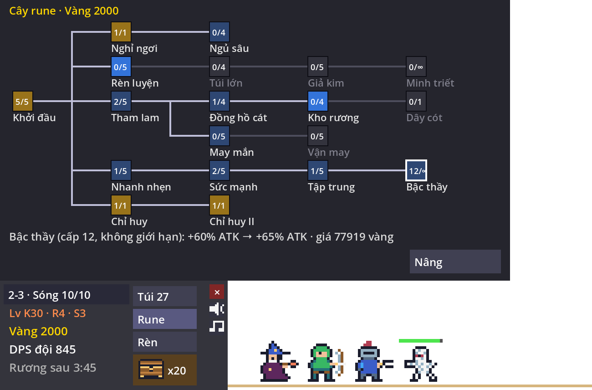

# Taskbar Idle

Game idle RPG chạy trong một dải trong suốt ngay trên thanh taskbar (trên macOS là ngay trên Dock). Đội hero tự đánh quái, rơi đồ, mở rương theo giờ thực, trong lúc bạn làm việc khác. Lấy cảm hứng từ thể loại "bottom-of-your-screen" và *TBH: Task Bar Hero*, nhưng toàn bộ tên, hình và âm thanh đều là của dự án này.

Làm bằng **Godot 4.7** (GDScript). Không có asset ngoài: sprite vẽ bằng lưới ký tự, âm thanh và nhạc tổng hợp bằng code.


| Túi đồ | Cây rune |
| --- | --- |
|  |  |

## Tính năng

- **Cửa sổ taskbar:** dải trong suốt, không viền, luôn nằm trên cùng. Chỉ HUD và panel bắt chuột; vùng còn lại bấm xuyên tới ứng dụng phía sau. Tự canh theo vùng làm việc của màn hình và scale Retina/DPI.
- **3 act × 10 màn:** Đồng cỏ, Sa mạc, Rừng tối. Số quái mỗi sóng tăng dần trong act, boss màn và boss act riêng (Vua xương, Sâu cát, Tử xà).
- **Đội 3 class:** Knight (đòn thứ 5 gây ×3), Ranger (20% chí mạng ×2), Sorcerer (cầu lửa ×4 mỗi 4 giây). Ô đội 2 và 3 mở bằng rune.
- **Đồ và ghép:** 6 phẩm từ Common đến Mythic, 3 loại (Kiếm, Găng, Nhẫn), ghép 9→1 có tỉ lệ thành công/đại thành công/thất bại, bán, tự ghép các bậc an toàn.
- **Rương theo giờ thực:** chỉ rơi khi game đang mở; tắt game thì chỉ nhận vàng và EXP offline (trần 4–8 giờ).
- **Cây rune 19 node:** chỉ số, rương, túi, offline, mở ô đội, và 2 rune không giới hạn cấp để tiêu vàng lâu dài.
- **Lò rèn:** cường hóa từng ô đồ của từng hero; Kiếm nhân ATK theo cấp số nhân. Từ +6 có thể thất bại nhưng không tụt cấp.
- **Portal:** quay lại bất kỳ màn đã mở; chế độ Lặp màn để cày.
- **Phạt EXP lệch level:** hero cao level hơn màn bị giảm EXP theo đường cong khớp bảng của TBH.
- **Âm thanh và nhạc:** 13 hiệu ứng và 3 bản nhạc nền theo act, tạo bằng code. Nút Bật/Nhỏ/Tắt cho âm thanh và Bật/Tắt cho nhạc.
- **Save:** JSON trong `user://save.json`, tự lưu mỗi 30 giây; save cũ được tự chuyển sang định dạng mới.

## Chạy game

Cần [Godot 4.7](https://godotengine.org/download) (bản thường, không cần .NET).

```bash
godot --path game
```

Trên macOS, nếu Godot nằm trong `/Applications`:

```bash
/Applications/Godot.app/Contents/MacOS/Godot --path game
```

Hoặc mở `game/project.godot` trong Godot Editor rồi bấm Run. Cửa sổ trong suốt chỉ hiện đúng khi chạy game, không hiện trong editor.

**Điều khiển:** bấm dòng màn/sóng để mở Portal; các nút Túi, Rune, Rèn mở panel tương ứng; nút rương mở rương; nút loa và nốt nhạc bật tắt âm thanh; nút × lưu và thoát.

## Build bản Windows

1. Cài export template Godot 4.7.2 (Editor → Manage Export Templates → Download and Install).
2. Export:

```bash
godot --headless --path game --export-release "Windows Desktop" build/windows/TaskbarIdle.exe
```

Kết quả là một file `.exe` duy nhất (khoảng 109 MB), đã nhúng sẵn dữ liệu game. File chưa được ký số nên Windows SmartScreen có thể cảnh báo khi mở lần đầu. Nếu nền hiện màu đen thay vì trong suốt: chuột phải file `.exe` → Properties → Compatibility → Disable fullscreen optimizations.

## Công cụ cho dev

| Lệnh | Việc |
| --- | --- |
| `godot --headless --path game --script res://test_sim.gd` | Chạy toàn bộ test. **Chỉ tính là qua khi in ra dòng bắt đầu bằng `OK`** (Godot trả exit 0 cả khi script lỗi parse). |
| `godot --headless --path game --script res://tools/balance.gd -- 48` | Bot chơi 48 giờ (mất vài giây), in tiến độ mỗi giờ và thời điểm tới từng màn. Dùng để chỉnh cân bằng. |
| `godot --path game --script res://tools/screenshot.gd -- out.png [bag\|rune\|forge\|portal] [stage=24] [wave=11] [fire]` | Render game ở một trạng thái bất kỳ ra PNG, không đụng tới save. |

## Cấu trúc

```
game/
  project.godot        cấu hình cửa sổ trong suốt, renderer Compatibility
  main.tscn, main.gd   cửa sổ, HUD, panel, vẽ, input, lưu/đọc save
  sim.gd               toàn bộ luật chơi và số cân bằng, không vẽ gì
  art.gd               sprite dạng lưới ký tự + bảng màu Sweetie 16
  sfx.gd               hiệu ứng âm thanh tổng hợp bằng code
  music.gd             nhạc nền theo act, tổng hợp bằng code
  test_sim.gd          test
  tools/               bot cân bằng, công cụ chụp ảnh
  art/                 nơi đặt PNG thay thế sprite (xem art/README.md)
docs/                  ảnh minh họa cho README
tbh-chi-tiet.md        nghiên cứu chi tiết về TBH (nguồn tham khảo)
thiet-ke-game-tuong-tu.md  tài liệu thiết kế ban đầu
GUIDELINES.md          quy ước làm việc với code
```

## Nhịp chơi hiện tại

Theo bot cân bằng (chơi chăm, mỗi phút ghé một lần): act 1 khoảng 40 phút, vào act 3 khoảng giờ thứ 5, tới 3-7 khoảng giờ 17, 3-9 khoảng giờ 45. Các hằng số nằm ở đầu `game/sim.gd`.

## Bản quyền nội dung

- Sprite: vẽ riêng cho dự án; bảng màu Sweetie 16 của GrafxKid (CC0).
- Âm thanh, nhạc: tạo bằng code trong dự án.
- Quái act 3 lấy từ thần thoại dân gian châu Âu (troll, basilisk, pixie, nhện khổng lồ, hồn ma), không dùng tên hay thiết kế riêng của Harry Potter hay của TBH.

Repo chưa có file LICENSE.
